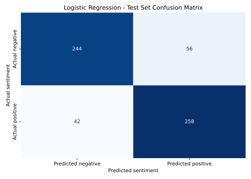
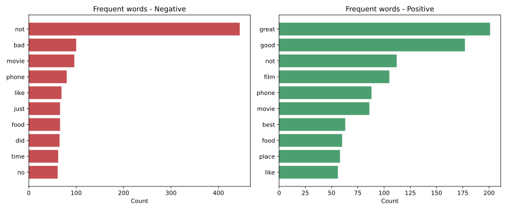

# Lab 01 - Sentiment Analysis Using Traditional Machine Learning

## Objective

Practice text preprocessing, Bag of Words feature extraction, traditional machine-learning classification, and sentiment-model evaluation.

## Dataset

The [UCI Sentiment Labelled Sentences dataset](https://archive.ics.uci.edu/dataset/331/sentiment%2Blabelled%2Bsentences) contains 3,000 review sentences from Amazon, IMDb, and Yelp. The data is balanced: 1,500 positive and 1,500 negative sentences. The script downloads the official UCI archive and caches it locally in an ignored `data/` folder.

Reference: Kotzias, D. (2015). *Sentiment Labelled Sentences*. UCI Machine Learning Repository. https://doi.org/10.24432/C57604

## Implementation

The solution is in [`sentiment_analysis.py`](sentiment_analysis.py). It performs the following steps:

1. Loads the three labelled text files from the UCI archive. It joins IMDb sentence continuations where a sentence is split across lines.
2. Converts text to lowercase, expands common contractions, removes punctuation, and normalizes whitespace.
3. Saves positive and negative examples showing original and cleaned text, then counts frequent words for each label.
4. Splits the data into an 80% training set and a 20% test set with stratification and `random_state=42`.
5. Creates unigram and bigram Bag of Words features with `CountVectorizer`, fitting its vocabulary on training text only.
6. Trains a logistic regression classifier and evaluates it on the held-out test set.
7. Predicts the sentiment of a new review sentence.

Run it with:

```text
pip install -r requirements.txt
python Lab-01-Machine-Learning/sentiment_analysis.py
```

## Results

The recorded results use one stratified 80/20 split of the combined dataset.

| Measure | Result |
|---|---:|
| Training sentences | 2,400 |
| Test sentences | 600 |
| Bag of Words features | 21,149 |
| Accuracy | 0.8367 |
| Precision (positive class) | 0.8217 |
| Recall (positive class) | 0.8600 |
| F1 score (positive class) | 0.8404 |

### Confusion matrix

| Actual / predicted | Negative | Positive |
|---|---:|---:|
| Negative | 244 | 56 |
| Positive | 42 | 258 |

The model predicted **Positive** for: “The food was delicious and the service was excellent.”

## Text exploration

Examples in `evidence/preprocessing_examples.csv` show the original and cleaned sentences for both labels. For instance, “Good case, Excellent value.” becomes “good case excellent value”, while “Needless to say, I wasted my money.” becomes “needless to say i wasted my money”.

The most frequent negative words include `not`, `bad`, and `movie`; frequent positive words include `great`, `good`, and `film`. `not` appears frequently in both classes, showing that word counts alone do not capture context. Words such as `phone`, `movie`, and `food` appear across domains and labels.

## Evidence

- [`run_output.txt`](evidence/run_output.txt): full printed evaluation and classification report.
- [`model_metrics.csv`](evidence/model_metrics.csv) and [`model_metrics.json`](evidence/model_metrics.json): measured metrics and confusion matrix.
- [`test_predictions.csv`](evidence/test_predictions.csv): actual and predicted labels for each test example.
- [`preprocessing_examples.csv`](evidence/preprocessing_examples.csv): original and cleaned examples from both classes.
- [`frequent_words.csv`](evidence/frequent_words.csv): word counts by sentiment.
- [`confusion_matrix.svg`](evidence/confusion_matrix.svg) and [`frequent_words.svg`](evidence/frequent_words.svg): generated result charts.





## Observations

The positive-class recall (0.86) is higher than the negative-class recall (0.81). The test set contains 56 false positives and 42 false negatives. The dataset is balanced, and the result reflects one hold-out split rather than repeated cross-validation. The frequent-word comparison also shows why a word's context matters: `not` occurs in both positive and negative sentences.

## Learning outcomes

This practical demonstrates how text cleaning and n-gram Bag of Words features turn sentences into model inputs. It also shows why fitting the vocabulary on training data only avoids test-set leakage, and why accuracy, precision, recall, F1, and a confusion matrix provide different views of model performance.

